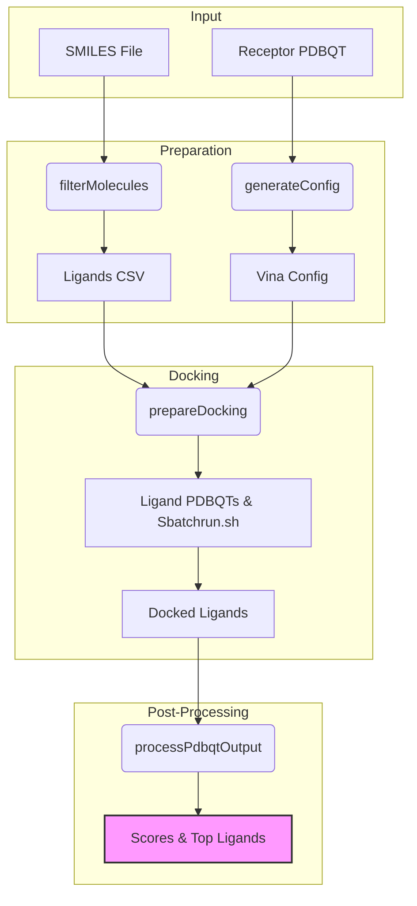

# Development Documentation - Slurm Batch Vina Docking

Welcome to the development guide for the Slurm Batch Vina Docking library. This document provides information on setting up the development environment, understanding the project architecture, and the core workflow.

## Project Overview

The Slurm Batch Vina Docking library is designed to optimize Vina docking in clusters managed by the Slurm Workload Manager. It streamlines the process of docking large ligand libraries against a receptor by parallelizing jobs using `sbatch`.

## Prerequisites

To contribute to or develop this library, you will need:
- **Python 3.10+**
- **Conda** (recommended for package management)
- **Slurm Workload Manager** (for running docking jobs)
- **AutoDock Vina** executable

## Setup Instructions

1. **Clone the repository:**
   ```bash
   git clone https://github.com/your-repo/SlurmBatch-VinaDock.git
   cd SlurmBatch-VinaDock
   ```

2. **Create and activate a conda environment:**
   ```bash
   conda create -n sbdock python=3.10
   conda activate sbdock
   ```

3. **Install dependencies:**
   ```bash
   pip install -r requirements.txt
   # Additional dependencies for docking operations
   pip install rdkit-pypi meeko pandas
   ```

## Project Structure

- `edu/mizzou/sbdock/`: Core library package.
  - `Sbatchdock.py`: Main API class providing methods for all operations.
  - `sbdock_cli_parser.py`: CLI interface for invoking operations via JSON config.
  - `operation/`: Individual modules for specific steps in the docking pipeline.
    - `FilterMolecules.py`: Filters SMILES and prepares a CSV.
    - `SmilesToPDBQT.py`: Converts SMILES to PDBQT format using RDKit and Meeko.
    - `GenerateConfig.py`: Generates the Vina configuration file.
    - `PrepareDocking.py`: Splits ligands into batches and creates `sbatch` scripts.
    - `ProcessPdbqtOutput.py`: Aggregates and processes Vina results.

## Core Workflow

The following Mermaid diagram illustrates the end-to-end docking workflow:



## Contributing

1. Fork the repository.
2. Create a new branch for your feature or bugfix.
3. Ensure your code follows the project's coding standards.
4. Submit a pull request with a detailed description of your changes.
